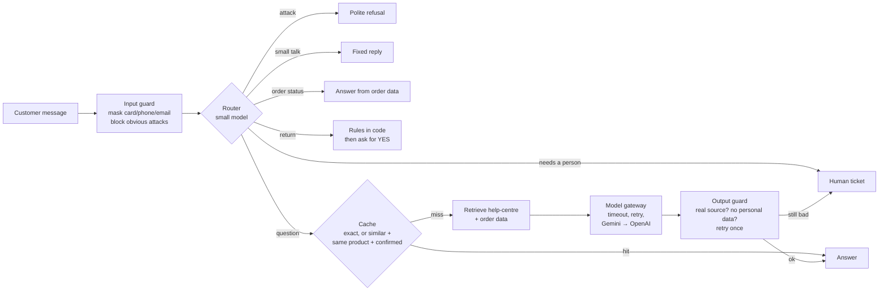

# BoltSound support assistant

A small but real AI support assistant for an imaginary headphone shop, **BoltSound**. It was built step by step for
Episode 9 of [AI Engineering Simplified](https://www.youtube.com/@AIEngineeringSimplified2026). Every step fixes a
problem we actually hit, and each step has a git tag, so you can check out any stage and see the code at that point.


## What happens to one message



Every step is recorded in a trace (shown in the UI). Every message is logged as one JSON line, using the masked
text only, for the dashboard.

## Run it

Python 3.10 or newer.

```bash
python -m venv .venv && source .venv/bin/activate
pip install -r requirements.txt
cp .env.example .env          # put your GEMINI_API_KEY in .env (OPENAI_API_KEY is optional: the fallback)
streamlit run ui/streamlit_app.py
```

Or from the terminal: `python -m app.cli "Can I return my X2 after 20 days?"`

## Test it

```bash
ruff check . && pytest            # unit tests: no API key, no cost, under a second
python -m evals.run               # 31 real questions against the real model, scored per slice
```

CI (`.github/workflows/ci.yml`) runs lint and tests on every push, and runs the evals on every pull request.
A pull request that drops the eval pass rate below 90% is blocked.

## Project layout

| Path | What it does |
|---|---|
| `app/assistant.py` | The flow above: one method per step |
| `app/guardrails.py` | Masking personal data, the attack phrase list, output checks |
| `app/router.py` | One small-model call picks the route |
| `app/retrieval.py` | Help-centre search (embeddings, one chunk per bullet) |
| `app/cache.py` | Exact cache, plus a similar-question cache that is checked before reuse |
| `app/gateway.py` | Timeouts, retrying transient errors, falling back to a second provider |
| `app/providers/` | Gemini, OpenAI, and a fake provider for tests, all behind one interface |
| `app/tools.py`, `app/returns.py` | Order lookup (own orders only) and returns (rules in code, explicit YES, never twice) |
| `app/handoff.py` | Human tickets |
| `app/monitoring.py`, `app/feedback.py` | Request log, dashboard summary, thumbs and implicit signals |
| `evals/` | The eval set and runner |
| `data/` | The fake shop: help-centre pages and three orders |

## The build, step by step

| Tag | Step | The real problem that drove it |
|---|---|---|
| `step-00` | Model only | Invented a 14-day return policy and wireless charging |
| `step-01`/`01b` | RAG | Whole-file chunks picked the X2 manual for a returns question |
| `step-02`/`02b` | Order tool | "bs2291" not recognised; Riya could see Arjun's order |
| `step-03`/`03b` | Input guardrails | A reworded attack slipped past the phrase list |
| `step-04` | Output guardrails | The bot promised a human, but nobody was told |
| `step-05`/`05b` | Gateway | 27 s answers: the model "thought" for 1,900 tokens; cost was under-counted |
| `step-06` | Router | "hi" took 20 s and created a human ticket |
| `step-07` | Cache | "Is the X2 waterproof?" got the X1 answer (similarity 0.84) |
| `step-08` | Returns | The same order could be refunded twice |
| `step-09` | Monitoring | Logs showed a billing question making the model think for 20 s |
| `step-10`/`10b`/`10c` | Evals + CI | A "friendlier" prompt kept tests green but dropped evals to 84% |
| `step-11` | Feedback | A 👎 landed on a correct answer |

## In real life you would add

A real ticketing system (Zendesk, Freshdesk), a session store (Redis), a vector database once you have thousands
of documents, tracing (OpenTelemetry or Langfuse), a trained guard model, and authentication. This repo keeps
those out so that every file stays short enough to read in one go.

## Licence

MIT. See [LICENSE](LICENSE). The shop, products and customers are made up.
