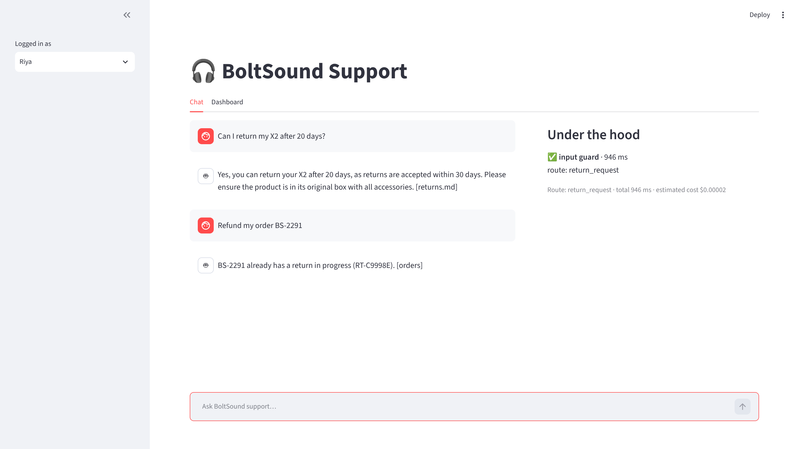
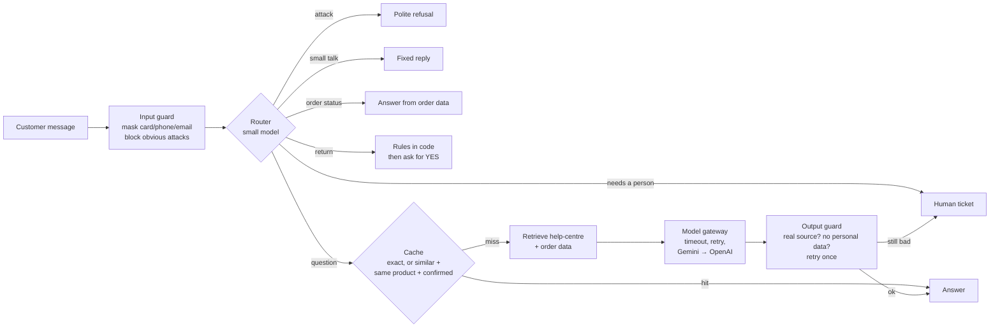
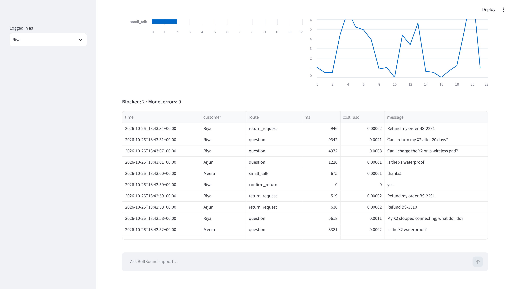

# BoltSound AI support assistant

[](https://github.com/ashutosh1412/boltsound-ai-app/actions/workflows/ci.yml)

[](LICENSE)

A small but **real** AI customer-support assistant for an imaginary headphone shop, **BoltSound**. It answers
questions from the shop's help centre, looks up orders, handles returns, keeps customers' data private, and hands
over to a human when it should.

It was built step by step in the finale of **AI Engineering Simplified**. Every step fixes a bug we actually hit,
and every step has a git tag, so you can open the code exactly as it was at any point in the video.

📺 **Watch the build:** [Build a Real AI App Step by Step](https://youtu.be/s9kXDbCNsL4) ·
**Channel:** [AI Engineering Simplified](https://www.youtube.com/@AIEngineeringSimplified2026)



## What's inside

- **RAG**: answers come from the help-centre pages, with the source page named in the reply
- **Tools**: order lookup, and customers only ever see their own orders
- **Guardrails**: card numbers, phone numbers and emails are masked before anything leaves the app; prompt attacks
  are blocked by a phrase list plus a small guard model; every answer is checked before it is shown
- **Human handover**: a real ticket is created, so "I'll connect you to a person" is never an empty promise
- **Model gateway**: timeouts, retries for temporary errors, and a fallback to a second provider (Gemini → OpenAI)
- **Router**: one cheap, small-model call decides where each message goes; small talk and order status skip the
  big model
- **Cache**: exact repeats are instant; similar questions are reused only for the same product, after a small
  model confirms they really ask the same thing
- **Actions that need a YES**: refunds follow rules written in code, need an explicit "yes", and can never happen
  twice
- **Monitoring**: one JSON log line per message (masked text only) and a dashboard
- **Evals in CI**: 31 real questions in 6 groups; a change that drops the pass rate below 90% is blocked
- **Feedback**: 👍/👎 buttons plus signals such as rephrasing or frustration, shown together on the dashboard

## What happens to one message



Every step is recorded in a trace, which the UI shows next to each answer.

## Quick start

You need Python 3.10 or newer and a Gemini API key (there's a free tier at
[Google AI Studio](https://aistudio.google.com/apikey)). An OpenAI key is optional; it's only used as the backup.

```bash
git clone https://github.com/ashutosh1412/boltsound-ai-app.git
cd boltsound-ai-app
python -m venv .venv && source .venv/bin/activate      # Windows: .venv\Scripts\activate
pip install -r requirements.txt
cp .env.example .env                                     # then put your GEMINI_API_KEY in .env
streamlit run ui/streamlit_app.py
```

Pick a customer in the sidebar (Riya, Arjun or Meera) and try:

- `Can I return my X2 after 20 days?`
- `Where is my order BS-2291?`
- `Is the X2 waterproof?`
- `Refund my order BS-2291`, then `yes`
- `My card was charged twice`

Or ask from the terminal:

```bash
python -m app.cli "Can I return my X2 after 20 days?"
```

### Settings (`.env`)

| Variable | Default | What it does |
|---|---|---|
| `GEMINI_API_KEY` | (required) | Main model, small model and embeddings |
| `OPENAI_API_KEY` | empty | Backup provider; leave empty to turn the fallback off |
| `MAIN_MODEL` | `gemini-flash-latest` | Writes the answers |
| `SMALL_MODEL` | `gemini-flash-lite-latest` | Router, guard and cache checks |
| `FALLBACK_MODEL` | `gpt-5-mini` | Used when Gemini fails |
| `MODEL_TIMEOUT_S` | `10` | Give up on a model call after this many seconds |
| `THINKING_LEVEL` | `low` | How long the main model may "think" before answering |

`.env` is in `.gitignore`. Never commit your keys.

## Tests and evals

```bash
ruff check . && pytest      # unit tests: fake model, no API key, no cost, under a second
python -m evals.run         # 31 real questions against the real model, scored per group
```

**Unit tests check the code. Evals check the answers.** CI (`.github/workflows/ci.yml`) runs lint and unit tests
on every push, and the evals on every pull request. To turn the eval gate on in your fork, add `GEMINI_API_KEY`
as a repository secret (Settings → Secrets and variables → Actions).

## Follow the build step by step

Each tag is one step from the video. To see the code at any step:

```bash
git checkout step-03       # the code as it was at that step
git diff step-03 step-03b  # exactly what the fix changed
git checkout main          # back to the finished app
```

| Tag | Step | The real problem that drove it |
|---|---|---|
| [`step-00`](../../tree/step-00) | Model only | Invented a 14-day return policy and wireless charging |
| [`step-01`](../../tree/step-01) / [`01b`](../../tree/step-01b) | RAG | Whole-file chunks picked the X2 manual for a returns question |
| [`step-02`](../../tree/step-02) / [`02b`](../../tree/step-02b) | Order tool | "bs2291" not recognised; Riya could see Arjun's order |
| [`step-03`](../../tree/step-03) / [`03b`](../../tree/step-03b) | Input guardrails | A reworded attack slipped past the phrase list |
| [`step-04`](../../tree/step-04) | Output guardrails | The bot promised a human, but nobody was told |
| [`step-05`](../../tree/step-05) / [`05b`](../../tree/step-05b) | Gateway | 27 s answers: the model "thought" for 1,900 tokens; cost was under-counted |
| [`step-06`](../../tree/step-06) | Router | "hi" took 20 s and created a human ticket |
| [`step-07`](../../tree/step-07) | Cache | "Is the X2 waterproof?" got the X1's answer (similarity 0.84) |
| [`step-08`](../../tree/step-08) | Returns | The same order could be refunded twice |
| [`step-09`](../../tree/step-09) | Monitoring | Logs showed a billing question making the model think for 20 s |
| [`step-10`](../../tree/step-10) / [`10b`](../../tree/step-10b) / [`10c`](../../tree/step-10c) | Evals + CI | A "friendlier" prompt kept tests green but dropped evals to 84% |
| [`step-11`](../../tree/step-11) | Feedback | A 👎 landed on a correct answer |
| [`step-12`](../../tree/step-12) | Finish | README, licence, final clean-up |

The branch [`marketing-tone`](../../tree/marketing-tone) is the "harmless" prompt change from the evals step. Run
`python -m evals.run` on it to watch the pass rate drop.



## Project layout

| Path | What it does |
|---|---|
| `app/assistant.py` | The flow above: one method per step |
| `app/guardrails.py` | Masking personal data, the attack phrase list, output checks |
| `app/router.py` | One small-model call picks the route |
| `app/retrieval.py` | Help-centre search (embeddings, one chunk per bullet) |
| `app/cache.py` | Exact cache, plus a similar-question cache that is checked before reuse |
| `app/gateway.py` | Timeouts, retrying temporary errors, falling back to a second provider |
| `app/providers/` | Gemini, OpenAI, and a fake provider for tests, all behind one interface |
| `app/tools.py`, `app/returns.py` | Order lookup (own orders only) and returns (rules in code, explicit YES, never twice) |
| `app/handoff.py` | Human tickets |
| `app/monitoring.py`, `app/feedback.py` | Request log, dashboard summary, thumbs and implicit signals |
| `ui/streamlit_app.py` | Chat and dashboard |
| `evals/` | The eval set and its runner |
| `tests/` | Unit tests (fake model, run in CI) |
| `data/` | The pretend shop: help-centre pages and three orders |

## In real life you would add

A real ticketing system (Zendesk, Freshdesk), a session store (Redis), a vector database once you have thousands
of documents, tracing (OpenTelemetry or Langfuse), a trained guard model, and proper login. This repo leaves
those out so that every file stays short enough to read in one go.

## Credits

The ideas follow *AI Engineering* by Chip Huyen (O'Reilly). The shop, products, orders and customers are made up.

## Licence

MIT. See [LICENSE](LICENSE).
